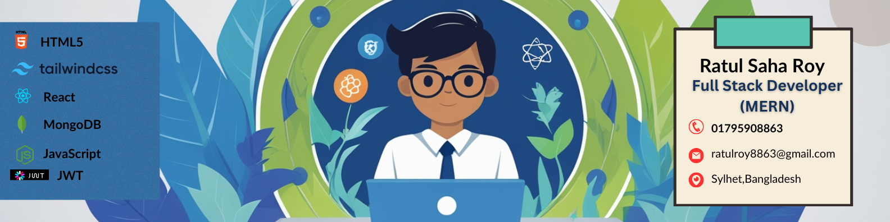

# Ratul Saha Roy

  

  

  <a href="https://ratul-saha-roy.pro.bd/">Portfolio</a> &nbsp;·&nbsp;
  <a href="https://github.com/Ratul8863">GitHub</a> &nbsp;·&nbsp;
  <a href="https://linkedin.com/in/ratul-saha-roy">LinkedIn</a> &nbsp;·&nbsp;
  <a href="mailto:ratulroy8863@gmail.com">Email</a> &nbsp;·&nbsp;
  <a href="https://ratul-saha-roy.pro.bd/doc/RATUL%20SAHA%20ROY_New_FS.pdf">Resume</a>

  

---

## About Me

I'm a Computer Science & Engineering student, software developer, and technology professional working across full-stack development, artificial intelligence, and research-driven computing.

I currently work as a **Junior Software Developer at Kode By Kraft**, contributing to production web applications, frontend engineering, backend systems, API integrations, and client projects. Alongside my software development role, I serve as **Head of Technologies & Digital Systems**, taking responsibility for technology initiatives, digital infrastructure, and software-driven solutions.

I'm pursuing my B.Sc. (Hons.) in Computer Science & Engineering at **Metropolitan University, Sylhet, Bangladesh**, with an expected graduation in July 2027.

Beyond application development, I'm interested in machine learning, deep learning, climate data, geospatial computing, remote sensing, and explainable AI. I enjoy connecting software engineering with research and practical problem-solving to build useful, reliable, and scalable solutions.

## Professional Experience

### Junior Software Developer — Kode By Kraft

**2025 – Present**

- Develop and maintain production-ready web applications and client-facing digital products.
- Build responsive interfaces using React.js, Next.js, JavaScript, and modern UI technologies.
- Implement backend functionality, REST APIs, authentication, and database integrations.
- Contribute to payment integrations, application workflows, and production deployments.
- Collaborate with the team to translate designs and requirements into working software.

### Head of Technologies & Digital Systems

**Technology Leadership**

- Lead technology initiatives and contribute to digital system development.
- Oversee website development, digital infrastructure, and technology-related workflows.
- Work across software implementation, technical planning, and platform improvement.
- Connect organizational needs with practical technology solutions.

## Education

**B.Sc. (Hons.) in Computer Science & Engineering**

Metropolitan University, Sylhet, Bangladesh

July 2023 – Present · Expected Graduation: July 2027

---

## What I Do

### 01 / Full-Stack Development

I build complete web applications across frontend and backend systems using React.js, Next.js, Node.js, Express.js, MongoDB, and MySQL. My work includes authentication, REST APIs, dashboards, CRUD systems, payment integrations, and production application workflows.

### 02 / AI & Machine Learning

I explore machine learning fundamentals, predictive modelling, intelligent applications, and deep learning. I'm interested in applying AI to practical software products and research problems, with a focus on interpretable and data-driven solutions.

### 03 / Research & Geospatial Computing

My research interests include climate data analysis, GIS, remote sensing, satellite imagery, and environmental monitoring. I explore spatiotemporal analysis and computational methods using datasets such as Landsat, Hansen Global Forest Change, JRC Tropical Moist Forest, and ESA Climate Change Initiative.

### 04 / Software Engineering & DevOps

I work across API design, database architecture, testing, application deployment, containerization, CI/CD, and performance improvement. I use tools such as Git, GitHub, Docker, GitHub Actions, and Postman, alongside deployment platforms including Vercel, Netlify, and Render.

### 05 / Technical Leadership & Problem Solving

I have contributed as a CTO, team leader, software developer, and technical team member across client projects, production applications, university initiatives, and innovation competitions. I enjoy collaborating with teams and turning ideas into working solutions.

---

## Technology Stack

  

  

**Development:** JavaScript, React.js, Next.js, Node.js, Express.js, HTML, CSS, Tailwind CSS.

**Databases & APIs:** MongoDB, MySQL, Firebase, REST APIs, authentication, and payment integrations.

**AI & Research:** Python, machine learning, climate-data analysis, GIS, remote sensing, and geospatial computing.

**Engineering & Tools:** Git, GitHub, Docker, GitHub Actions, Postman, Vercel, Netlify, Render, and Figma.

---

## Selected Projects

### 01. The Peptide Journey

**Full-Stack E-Commerce**

A production-oriented e-commerce platform featuring a custom storefront, guest checkout, inventory reservation, authentication, and payment integration.

`Next.js` `TypeScript` `MongoDB` `Auth.js`

[View Project](https://peptide.up.railway.app/giveaway) · [Portfolio](https://ratul-saha-roy.pro.bd/projects)

### 02. MK Heating

**Business Website & Local SEO**

A conversion-focused website for a heating and plumbing business, featuring service pages, location-specific content, booking calls to action, and a responsive interface.

`Next.js` `React` `Tailwind CSS`

[Live Website](https://www.boilerserviceeastlondon.co.uk/) · [Portfolio](https://ratul-saha-roy.pro.bd/projects)

### 03. AJ Cleaning London

**Marketing Website & UI Engineering**

A responsive marketing website developed from a Figma redesign, with reusable design patterns, service and location pages, mega navigation, and an interactive Matter.js-powered call to action.

`HTML` `CSS` `JavaScript` `Matter.js`

[Live Website](https://aj-cleaning-london.vercel.app/) · [Portfolio](https://ratul-saha-roy.pro.bd/projects)

### 04. GroundRoots Initiative

**Full-Stack Community Platform**

A digital platform for a London youth community organisation, combining a public website, Stripe-powered shop, and an Academy Tracker for coaching and community activities.

`React` `Vite` `Express.js` `Stripe`

[Live Website](https://groundroots.org) · [Portfolio](https://ratul-saha-roy.pro.bd/projects)

### 05. EMS Logistics UK

**Corporate Web Platform**

A multi-page corporate platform for a UK logistics company, covering services, partnerships, careers, and quote capture through a responsive interface.

`Next.js` `React` `TypeScript` `Tailwind CSS`

[Live Website](https://www.emslogistics.co.uk/) · [Portfolio](https://ratul-saha-roy.pro.bd/projects)

### 06. As-Subah Outreach

**Fundraising & Donation Platform**

A full-stack outreach platform supporting donation workflows, fundraising campaigns, payment integration, and administrative operations.

`React` `Express.js` `MongoDB` `Stripe`

[Live Website](https://assubahoutreach.com) · [Portfolio](https://ratul-saha-roy.pro.bd/projects)

### 07. Jubileean Football Fest

**Sports Platform & Real-Time Features**

A football tournament platform built to support team and player information, fixtures, leaderboards, and real-time functionality.

`React` `Vite` `Node.js` `Express.js` `MongoDB` `Socket.IO`

[Live Website](https://jubileean-football-fest.vercel.app/) · [Portfolio](https://ratul-saha-roy.pro.bd/projects)

[Explore All Projects](https://ratul-saha-roy.pro.bd/projects)

---

## AI, Data & Research

I'm interested in research problems that combine machine learning, environmental data, and computational analysis.

### Interpretable Machine Learning for Rainfall Predictability

Exploring interpretable machine learning approaches for rainfall prediction and uncertainty-aware scenario generation in Bangladesh's Haor Basin.

**Research interests**
- Climate-data analysis and predictive modelling.
- Explainable AI and model interpretability.
- GIS and satellite-based environmental monitoring.
- Remote sensing and land-cover change analysis.
- Spatiotemporal analysis and causal-impact assessment.

My goal is to connect software engineering, machine learning, and geospatial research to develop useful analytical tools and evidence-based solutions.

---

## Achievements & Recognition

| Competition / Programme | Recognition |
|---|---|
| Hult Prize at Metropolitan University, 2026 | On-Campus Champion |
| The Infinity AI BuildFest, 2026 | Finalist |
| MillionX AI Build-a-Thon, 2026 | Top 60 Finalist |
| NASA Space Apps Challenge, 2025 | 2nd Runner-Up, Sylhet Regional |
| InnovateX Hackathon, 2025 | Top 50 Finalist |
| Intra-MU Debating Competition, 2025 | Runner-Up |
| Programming Hero, 2025 | Black Belt Web Developer |

---

## Leadership & Community

**Metropolitan University Debating Club**  
Organising Secretary — contributing to the coordination and execution of university debating activities.

**Metropolitan University Geography & Astronomical Society**  
Joint Secretary — contributing to technical, academic, astronomy, geography, and community initiatives.

**EcoScrap — Hult Prize**  
CTO — contributing to technical direction, architecture, and system design for a circular-economy solution.

**EarthSync — InnovateX Hackathon**  
Team Leader — leading technical collaboration through development and competition preparation.

---

## GitHub Analytics

  
  

  

---

## Let's Connect

I'm open to meaningful collaborations in software development, AI-driven applications, research technology, and innovative digital products.

  
  

  Build thoughtfully. Engineer reliably. Create meaningful impact.

